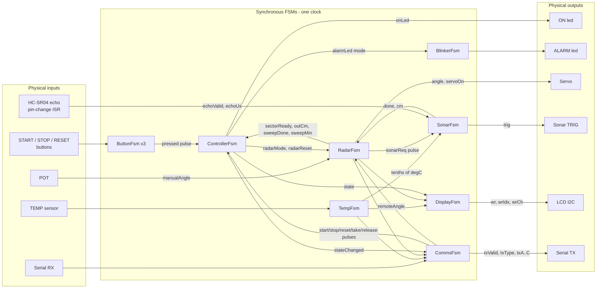
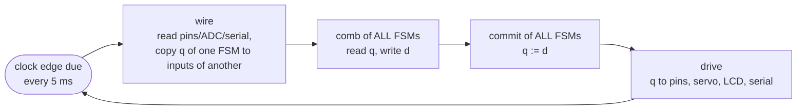
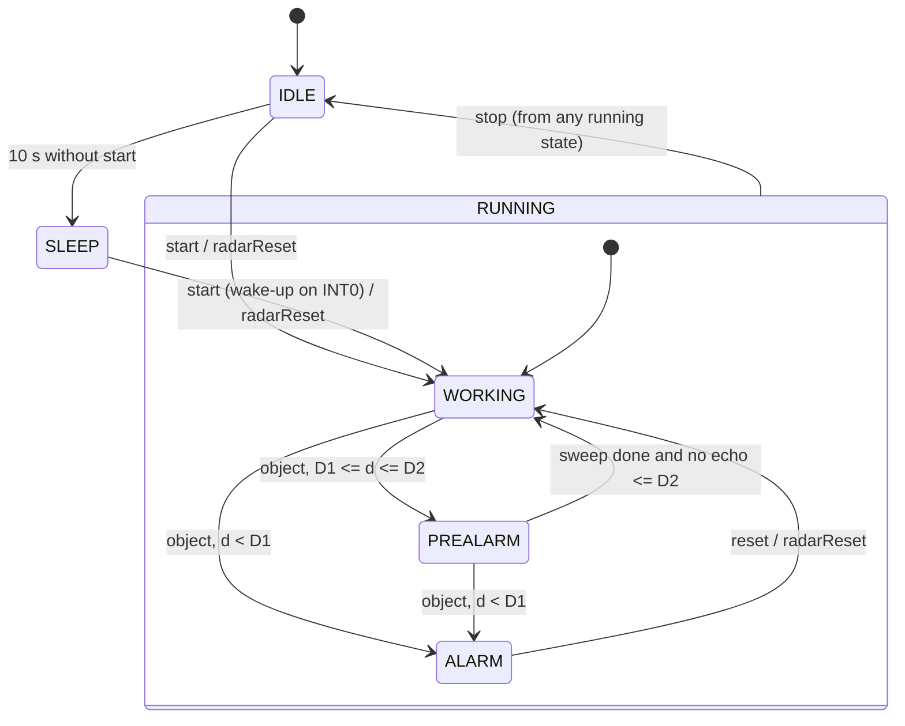
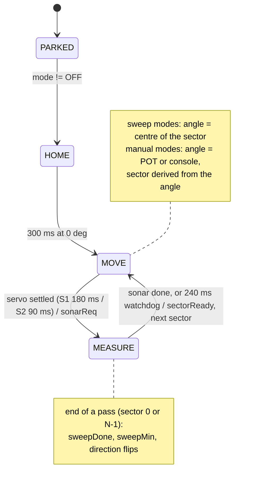
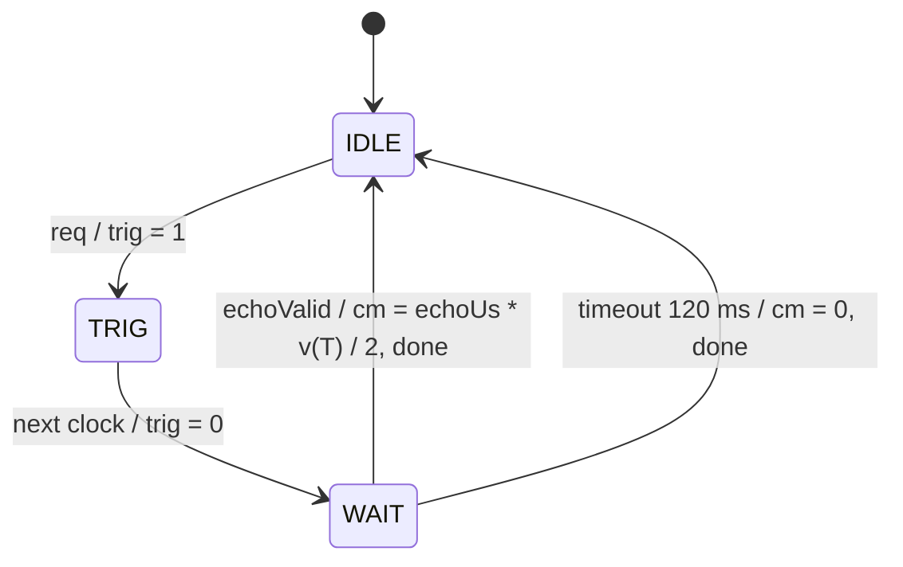
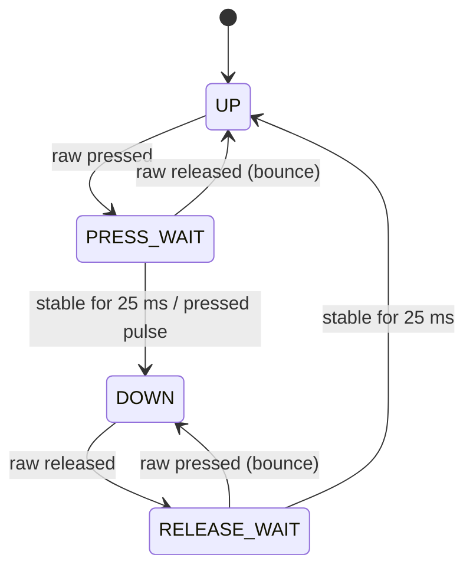
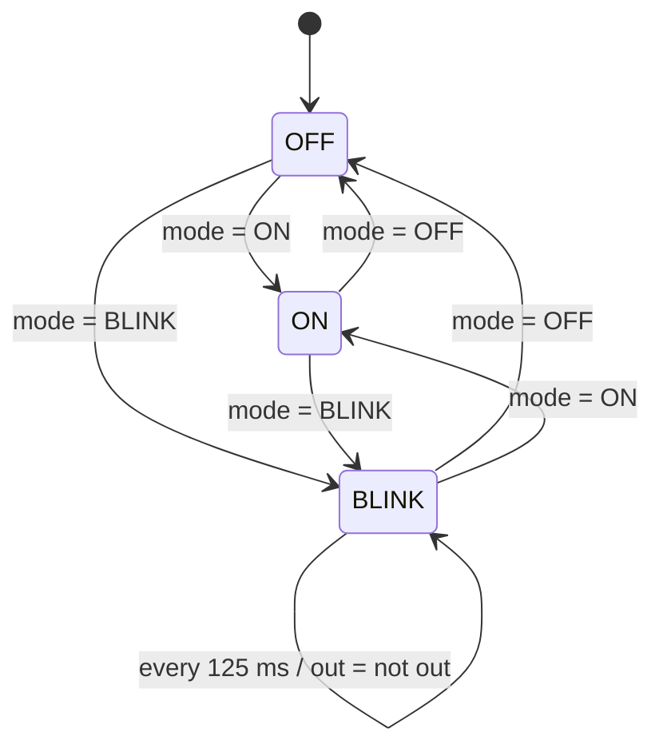
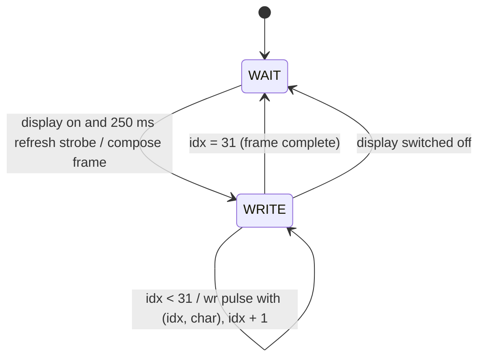
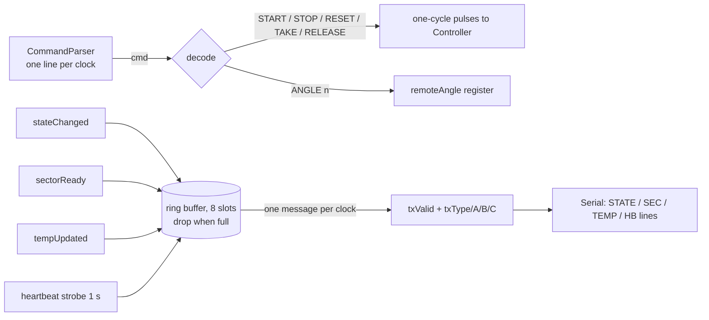
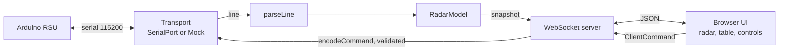

# RSU – FSM diagrams

All diagrams are generated from the firmware in `radar-subsystem-unit/` (state names and
conditions match the code). Mermaid renders on GitHub, VS Code (Markdown Preview Mermaid
Support) and https://mermaid.live.

Conventions: `A --> B : condition / action`. *Pulse* = signal that is high for exactly one clock
period. *Moore output* = depends only on the state; *Mealy output* = depends on state and input.

---

## 1. Architecture: one clock, many synchronous FSMs

The RSU is modelled like a VHDL design. There is a single clock (`CLK_MS = 5 ms`). Every FSM has
registers (`Reg<T>`: current value `q`, next value `d`). On every clock edge:

1. **wire** – concurrent assignments: registered outputs of one FSM feed the inputs of another,
   plus the physical inputs (pins, ADC, serial);
2. **comb()** – every FSM computes its next state from `q` values only and writes only `d`;
3. **commit()** – all registers take `q <= d` at the same instant.

Because comb() never changes `q`, the order of the FSMs is irrelevant (as in hardware), and a
signal produced in cycle *n* is seen by its consumer in cycle *n + 1*.



### The clock cycle



---

## 2. ControllerFsm – top-level behaviour

States: `IDLE`, `SLEEP`, `WORKING`, `PREALARM`, `ALARM`.
Inputs: `start`, `stop`, `reset` (button or console), measurement `meas` with distance `measCm`,
`sweepDone` with `sweepMinCm`.
`D1 = 30 cm`, `D2 = 80 cm` (see `Config.h`).



> The diagram nests the three running states in one box only to avoid drawing three `stop`
> arrows. In the code the `stop` transition exists separately in WORKING, PREALARM and ALARM, and
> an alarm has priority over a pre-alarm when both are detected in the same cycle.

**Outputs (Moore – function of the state only)**

| State | ON led | ALARM led | Radar mode | LCD / servo |
|---|---|---|---|---|
| IDLE | off | off | OFF | off, servo parked |
| SLEEP | off | off | OFF | off, MCU in deep sleep |
| WORKING | on | off | SWEEP_S1 (slow) | on |
| PREALARM | on | **on (steady)** | SWEEP_S2 (fast) | on |
| ALARM | on | **blinking** | MANUAL_POT (operator) | on |

With remote control taken (`remote = 1`) the radar mode in any running state is `MANUAL_REMOTE`.

**Mealy outputs (pulses)**: `stateChanged` on every transition (the console receives `STATE,…`),
`radarReset` on IDLE→WORKING, SLEEP→WORKING and ALARM→WORKING (radar returns to 0°).

---

## 3. RadarFsm – sector by sector sweep



Transitions that apply from **any** state:

| Condition | Next state |
|---|---|
| `mode == OFF` (idle / sleep) | `PARKED` (servo detached) |
| `reset` pulse (alarm cleared, new start) | `HOME` (back to 0°, sector 0, direction forward) |

The sector order in a sweep is `0 → N-1`, then `N-1 → 0` (forward and backward), with each
end sector measured once per pass.

---

## 4. SonarFsm – non-blocking HC-SR04 measurement

No `pulseIn()` is used. The width of the echo is measured by an interrupt service routine on
a pin-change interrupt (PCINT0, D8); the FSM only sees the result as the synchronised signals `echoValid` / `echoUs`.



`v(T) = 331.3 + 0.606 · T` m/s, with `T` from the temperature sensor (calibration of the sound
speed, as required). Distances above `SONAR_MAX_CM` give `cm = 0` (nothing in range).

---

## 5. ButtonFsm – debounce (one instance per button)



---

## 6. BlinkerFsm – ALARM led driver



(`mode` comes from the Moore output `alarmLed()` of the Controller: OFF, ON in pre-alarm, BLINK in alarm.)

---

## 7. DisplayFsm – non-blocking LCD refresh

An I2C LCD is slow, so one character is written per clock tick instead of blocking for a whole
frame.



Screen layout:

```
PREALARM 23.5C        <- state, temperature
S5/12   45cm          <- last visited sector, distance ("clear" if no object)
```

---

## 8. CommsFsm – serial link

CommsFsm is a small datapath around a queue rather than a state graph.



Protocol (ASCII, one line per message):

| Direction | Line | Meaning |
|---|---|---|
| RSU → CSU | `STATE,<id>,<NAME>` | state change |
| RSU → CSU | `SEC,<sector>,<angle>,<cm>,<detected>` | one sector measurement |
| RSU → CSU | `TEMP,<tenths>` | temperature in 0.1 °C |
| RSU → CSU | `HB,<stateId>,<remote>` | heartbeat every 1 s |
| CSU → RSU | `START`, `STOP`, `RESET` | control (RESET clears the alarm) |
| CSU → RSU | `TAKE`, `RELEASE`, `ANGLE,<0..180>` | optional remote control of the radar |

---

## 9. CSU (PC, TypeScript) – data flow


