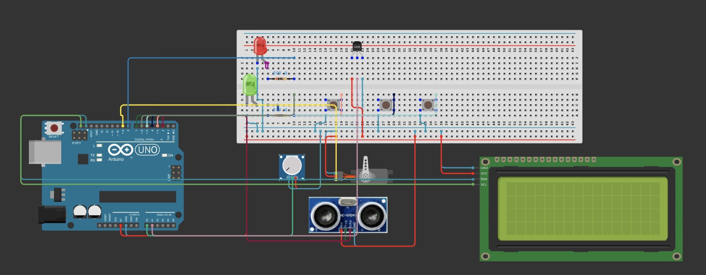

# Assignment #02 – Smart Radar System (SRS)

Embedded Systems and IoT – ISI LT – a.y. 2025/2026

Deliverable layout: `radar-subsystem-unit/` (Arduino, C++), `console-subsystem-unit/` (PC, TypeScript), `doc/` (this report, diagrams, video).

## 1. Overview

The system has two parts connected through the serial line (115200 baud, ASCII lines):

- **RSU** (Radar Subsystem Unit, Arduino UNO): sonar on a servo, three buttons, two LEDs, potentiometer, I2C LCD and a temperature sensor.
- **CSU** (Console Subsystem Unit, PC): a Node.js + TypeScript program serving a browser GUI (radar view, sector table, controls). It also implements the optional remote control.

## 2. RSU design: synchronous FSMs driven by one clock

The assignment asks for task-based architecture with synchronous FSMs. The firmware is written the way a synchronous design is written in VHDL:

| VHDL | C++ in this project |
|---|---|
| `signal s : T` | `Reg<T>` with current value `q` and next value `d` |
| combinational process | `Fsm::comb()` – reads only `q`, writes only `d` |
| `rising_edge(clk)` | `Fsm::commit()` – `q := d` for all registers at once |
| clock | `Clock::tick()` every `CLK_MS = 5 ms` |
| clock-enable | `Strobe` (counter that pulses every N ticks) |
| one-cycle signal | `Pulse` |

Every task is an FSM with one `comb()` and one `commit()`. All FSMs share the same clock, so no task blocks (no `delay()`, no `pulseIn()`) and the order in which FSMs are evaluated does not matter. A signal produced in cycle *n* is seen by its consumer in cycle *n + 1*, exactly as in hardware.

| FSM | Task |
|---|---|
| `ControllerFsm` | system states: idle, sleep, working, pre-alarm, alarm |
| `RadarFsm` | servo position per sector, measurement sequence, sweep passes |
| `SonarFsm` | HC-SR04 measurement without blocking, speed of sound from temperature |
| `ButtonFsm` ×3 | debounce |
| `BlinkerFsm` | ALARM led (off / steady / blinking) |
| `TempFsm` | temperature sampling every 500 ms |
| `DisplayFsm` | LCD refresh, one character per clock |
| `CommsFsm` | serial commands in, message queue out |

The state diagrams of all FSMs are in **`fsm-diagrams.md`** (Mermaid).

### Behaviour implemented

- **Idle**: everything off, the MCU goes to deep sleep after 10 s (power-down mode); only START (INT0) wakes it.
- **Working**: ON led on, radar at 0° and then sweeping forward and backward over N = 12 sectors at speed S1 (180 ms/sector). For each sector the distance is measured; sector number and detection are shown on the LCD and sent to the console. The sound speed is calibrated with the temperature sensor: `v = 331.3 + 0.606·T` m/s.
- **Pre-alarm**: an object at distance D1 ≤ d ≤ D2 (30–80 cm) → ALARM led steady on and the sweep speed rises to S2 (90 ms/sector). The system returns to working when a complete pass finds nothing within D2.
- **Alarm**: an object closer than D1 → ALARM led blinks (4 Hz) and the radar is moved by the operator with the potentiometer. Only RESET leaves the state: the radar returns to 0°, the led turns off, normal work resumes.
- **STOP** (extra) returns to idle from any working state.
- **Optional remote control** (console): TAKE CONTROL / RELEASE CONTROL, RESET and an angle slider (`ANGLE,<0..180>`).

### Serial protocol

| Direction | Line | Meaning |
|---|---|---|
| RSU → CSU | `STATE,<id>,<NAME>` | state change |
| RSU → CSU | `SEC,<sector>,<angle>,<cm>,<detected>` | sector measurement (`cm = 0`: no echo) |
| RSU → CSU | `TEMP,<tenths>` | temperature in 0.1 °C |
| RSU → CSU | `HB,<stateId>,<remote>` | heartbeat, 1 Hz |
| CSU → RSU | `START`, `STOP`, `RESET` | control |
| CSU → RSU | `TAKE`, `RELEASE`, `ANGLE,<n>` | remote control of the radar |

Plain text was chosen deliberately: it can be read in the serial monitor and needs no framing at this data rate.

## 3. Circuit



Pin assignment (all in `radar-subsystem-unit/Config.h`):

| Component | Pin | Note |
|---|---|---|
| START button | D2 | INT0, `INPUT_PULLUP`, only pin that wakes the MCU |
| HC-SR04 ECHO | D3 | INT1, pulse width measured in an ISR |
| STOP button | D4 | `INPUT_PULLUP` |
| RESET button | D5 | `INPUT_PULLUP` |
| HC-SR04 TRIG | D6 | |
| ON led (green) | D7 | 220 Ω series resistor |
| ALARM led (red) | D8 | 220 Ω series resistor |
| Servo | D9 | Timer1 / Servo library |
| Potentiometer | A0 | |
| Temperature sensor (LM35) | A1 | `TEMP_IS_TMP36 = 0` |
| LCD I2C | SDA / SCL | address `0x27` (`LCD_I2C_ADDR`) |

## 4. CSU design (TypeScript)

```
Arduino ⇄ serial ⇄ Transport ─ parseLine ─ RadarModel ─ snapshot ⇄ WebSocket ⇄ browser GUI
                       ▲ (SerialPort or built-in simulator)
```

- `server/protocol.ts` parses and validates lines; malformed input never throws.
- `server/model.ts` is the console's picture of the RSU (state, 12 sectors, temperature, remote flag, link health from the heartbeat).
- `server/transport.ts` is the serial link with automatic reconnect; `server/mock.ts` simulates an RSU, so the console can be tested without hardware.
- `server/server.ts` serves the GUI and pushes snapshots over WebSocket. Only valid commands are forwarded to the Arduino; the server listens on `127.0.0.1` only.
- `src/app.ts` draws the half-circle radar (sector colour: not scanned / clear / pre-alarm range / alarm range, echo marker at the measured distance, servo needle), the sector table and the controls.

### Running the console

```bash
cd console-subsystem-unit
npm install
npm run build
node dist/server/main.js --list                       # list serial ports
node dist/server/main.js --port /dev/cu.usbmodemXXXX  # real Arduino
npm run mock                                          # simulator, no hardware
# then open http://127.0.0.1:3000
```

## 5. Testing

- **Firmware logic** is hardware-independent and tested on the PC (`radar-subsystem-unit/test/`, g++): Controller transitions, debounce, blinker, temperature conversion, sonar timing and timeout, command parser, message queue, LCD frame, and a full-system simulation with a fake sonar (start → sweep → pre-alarm → alarm with potentiometer → reset → stop).
  ```bash
  cd radar-subsystem-unit/test
  for t in controller system comms; do g++ -std=c++17 -Wall -Wextra -I.. test_$t.cpp -o /tmp/t_$t && /tmp/t_$t; done
  ```
- **Console**: `npm test` (protocol, model, end-to-end through the real WebSocket server).

## 6. Libraries and demo

Arduino libraries: `Servo`, `Wire`, `LiquidCrystal_I2C`. Console: `serialport`, `ws`, TypeScript.

Demo video: _link / file to be added_.
